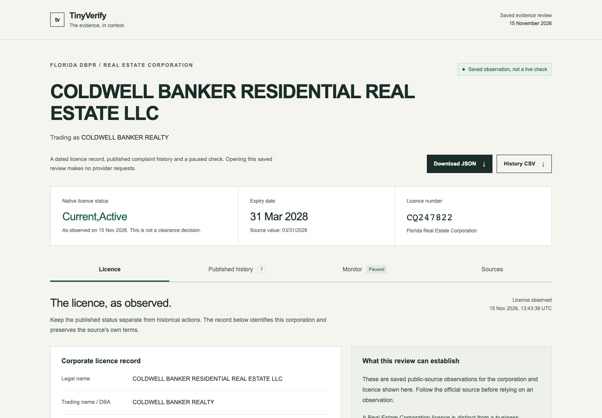

# TinyVerify

A business record should leave a useful trail: the official status, its source, when it was checked and what is still unknown. TinyVerify produces structured registration and corporate-licence records, then compares selected status and expiry observations.

Open the **[reviewed Florida example](evidence/release/review.html)** in a browser, or watch the **[74-second demo](media/tinyverify-demo.mp4)**. It contains the actual licence fields, a separately checked public history listing, a paused Monitor verification and working JSON/CSV downloads. Opening the saved review makes no provider requests.



## Try the tool

Requires Node.js 22 or newer, npm and a local macOS/Linux filesystem.

```sh
npm ci --ignore-scripts --no-audit --no-fund
npm run demo
npm run plan -- examples/request-gb.json
```

The demo is explicitly synthetic and makes zero provider calls. Its fictional cancellation is a test example, not an observed registry change. The saved Florida review is a separate, genuine provider observation from 15 November 2026.

The registration planner accepts a business name, place and supported record type. Florida corporate licences have their own typed discovery, selection, detail and history workflow. [Operator setup](docs/RUNTIME.md).

## Coverage

| Official source              | Record type                     | Evidence boundary                                                                                         |
| ---------------------------- | ------------------------------- | --------------------------------------------------------------------------------------------------------- |
| UK Companies House           | Company registration            | Historical genuine Fetch samples; registration is distinct from a professional licence.                   |
| Australian Business Register | ABN registration                | Historical genuine Fetch samples; missing licence expiry and discipline stay unknown.                     |
| Florida DBPR                 | Real Estate Corporation licence | Verified Agent discovery, independent detail Fetch, public history check and finite Monitor verification. |

Florida discovery returns an observed candidate for explicit selection. It does not turn one result into a uniqueness claim. Malformed candidates, unsupported record types, missing matches and conflicting identities do not produce a guessed record.

## What the verified example shows

The Florida source reported licence `CQ247822` as `Current,Active`, with expiry **31 March 2028**. Its published listing contained seven historical rows and four explicit fine/sanction descriptions. Three blank descriptions remain unknown; the source's `01/01/1901` incident values remain unknown placeholders.

The listing is non-exhaustive. Historical actions do not override the current native status, and a closed case or Final Order alone is not treated as discipline. Ordinary signed-out source review independently matched the selected licence fields and all seven rows. [Source QA](docs/VERIFICATION.md).

The Monitor baseline and follow-up found the selected status/expiry fields unchanged, then the Monitor was confirmed paused. That comparison is client-derived; missing provider outcome metadata stays unknown. The Monitor does not recheck the separate complaint listing, and no delivered alert or naturally occurring change is claimed.

## How TinyFish contributes

**Agent** operates the official registry forms and reads the selected public history. **Fetch** independently corroborates the chosen licence fields. **Monitor** supplies two real observations of the exact selected detail URL. Typed validation keeps the source's literal values, date quality and coverage separate from interpretation.

The live operator is disabled by default. It requires your own account, key and a finite private permit with bounded steps, time, spend and cleanup. Agent restrictions are goal instructions, not a server-side action allowlist. No login or saved profile is used for this public corporate workflow.

## Reuse and verify

The reviewed package includes JSON, CSV and an offline HTML review. Each preserves source URLs and observation dates. Replay and opening an export do not recheck current status.

```sh
npm test
npm run typecheck
npm run build
npm run format:check
npm run verify
```

The current source passes 132 tests, including literal status-change regressions, and a fresh standalone verification gate. The 15 November live evidence retains its original source identity; the later comparison repair was verified offline. Read [verification and limits](docs/VERIFICATION.md) and [live controls](docs/RUNTIME.md). This is a local tool and saved judge package; no hosted service, legal clearance or organizer approval is claimed.

There is no repository licence file in this candidate. Public availability does not grant an open-source licence; dependency licence notices remain with their packages. See [sources and originality](docs/SOURCES.md).
